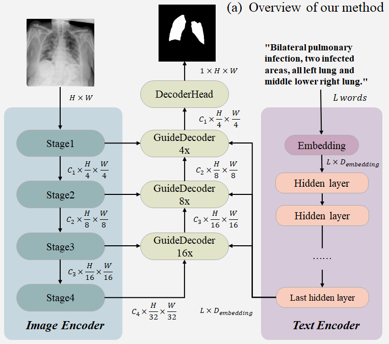
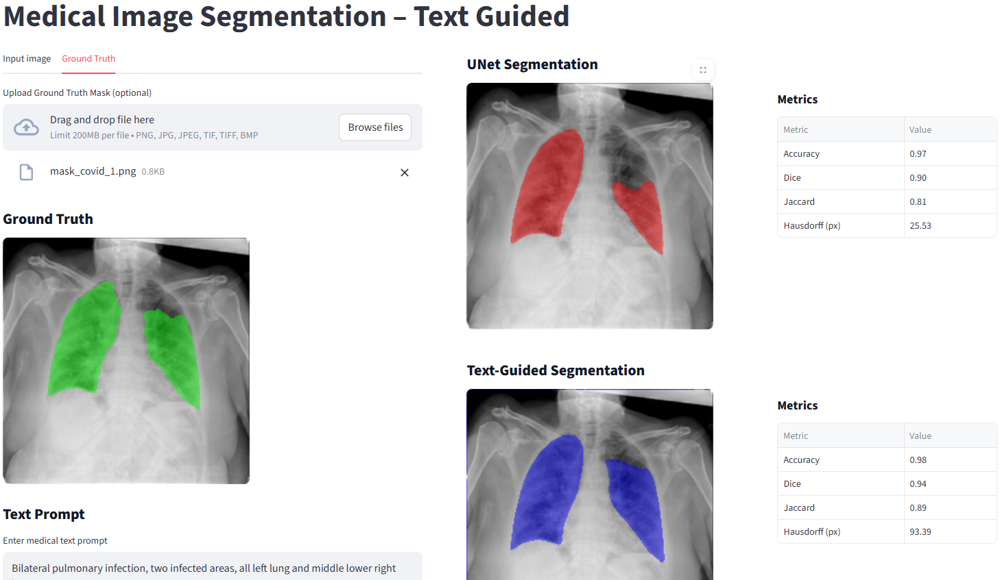

# Text-Guided Segmentation in Medical Imaging

This project investigates whether natural-language prompts can improve medical image segmentation compared with a conventional image-only U-Net baseline. It evaluates a text-guided segmentation approach on two public datasets: **QaTa-COVID19** and **MoNuSeg**.

The experiments use **LanGuideMedSeg** to combine visual features from medical images with semantic information from text prompts. A Streamlit interface was also implemented to upload images and compare segmentation outputs.

## Table of Contents

- [Overview](#overview)
- [Datasets](#datasets)
- [Methodology](#methodology)
- [Results](#results)
- [Key Findings](#key-findings)
- [Demo Interface](#demo-interface)
- [Limitations](#limitations)
- [Authors](#authors)

## Overview

Traditional medical image segmentation models primarily use visual information to predict pixel-level masks. Text-guided segmentation additionally uses natural-language descriptions to direct the model toward regions of interest.

Example prompts include:

- `Unilateral pulmonary infection, one infected area, lower right lung`
- `The nuclei density in the upper right is high`

The goal of this project is to assess when textual guidance is useful and how its impact differs between medical imaging tasks.

## Datasets

The experiments use two publicly available datasets:

| Dataset | Image type | Segmentation target |
|---|---|---|
| **QaTa-COVID19** | Chest X-ray images | COVID-19-related infected regions |
| **MoNuSeg** | Histopathology images | Cell nuclei and their boundaries |

The annotations used in the experiments were obtained from the dataset resources described in the project paper.

## Methodology

### Text-guided model

The project uses **LanGuideMedSeg**, a framework that combines image and text representations to guide segmentation.

Its main components are:

1. **Image encoder — ConvNeXt-Tiny:** extracts hierarchical visual features at multiple scales.
2. **Text encoder:** processes natural-language prompts into semantic embeddings. CXR-BERT was used for the chest X-ray experiments; the MoNuSeg experiments used a general-purpose BERT model.
3. **GuideDecoder:** fuses visual and textual features through attention-based mechanisms and generates pixel-level segmentation predictions.

During training, text prompts provide semantic supervision intended to guide the model toward image regions matching the descriptions.

### Baseline and comparison

A conventional **U-Net** model was trained separately for each dataset using image inputs and pixel-level annotations without textual supervision.

The text-guided model was evaluated both with and without prompts to help assess the effect of text guidance.

### Evaluation metrics

The models were evaluated using:

- **Dice score** — overlap between predicted and reference segmentation masks.
- **Intersection over Union (IoU)** — overlap relative to the union of the masks.
- **Hausdorff distance at the 95th percentile (Hausdorff95)** — boundary-distance measure; lower values indicate better boundary localization.
- **Pixel accuracy** — proportion of correctly classified pixels.

## Results

### QaTa-COVID19

| Model | Dice ↑ | IoU ↑ | Hausdorff95 ↓ | Accuracy ↑ |
|---|---:|---:|---:|---:|
| U-Net | 0.76 | 0.85 | 33.3 | 0.97 |
| **Text-guided** | **0.84** | **0.90** | **16.7** | **0.98** |
| Text-guided, no text input | 0.70 | 0.77 | 46.6 | 0.95 |

On QaTa-COVID19, the text-guided model achieved the best reported results across all four metrics. Compared with U-Net, Dice increased from 0.76 to 0.84, while Hausdorff95 decreased from 33.3 to 16.7.

### MoNuSeg

| Model | Dice ↑ | IoU ↑ | Hausdorff95 ↓ | Accuracy ↑ |
|---|---:|---:|---:|---:|
| **U-Net** | **0.75** | **0.74** | 5.3 | **0.89** |
| Text-guided | 0.69 | 0.68 | **3.9** | 0.87 |
| Text-guided, no text input | 0.69 | 0.68 | 4.0 | 0.87 |

On MoNuSeg, U-Net achieved better overlap scores and pixel accuracy. The text-guided model achieved the lowest Hausdorff95 value, suggesting somewhat more precise boundary localization despite lower overall overlap.

## Key Findings

- **Text guidance helped on QaTa-COVID19:** the text-guided model outperformed the U-Net baseline on all reported metrics.
- **The benefit was limited on MoNuSeg:** U-Net had better Dice, IoU, and pixel accuracy, while text guidance modestly improved the boundary-distance metric.
- **Prompt–image alignment matters:** textual descriptions appear most useful when they correspond closely to clinically relevant image regions.
- **Fine structures remain challenging:** the MoNuSeg results showed limited granularity when capturing detailed nuclear structures.

Possible contributing factors discussed in the project include the limited amount of MoNuSeg training data and differences in text-encoder suitability for the two domains.

## Demo Interface

A **Streamlit** interface was implemented to allow users to upload medical images and view segmentation outputs from the U-Net baseline and the text-guided model.

## Limitations

- Results differ between datasets; text guidance does not guarantee improved segmentation.
- Fine-grained nuclear structures remain difficult to segment accurately.
- Reproduction of several alternative frameworks was limited by dependencies and implementation issues.
- Performance depends on the quality and relevance of the prompts and the alignment between the text encoder and the imaging domain.
- This project is an experimental research study, not a clinically validated diagnostic tool.

## Authors

**Maja Katharina Nikolic** and **Fatemeh Aghaei**  
University of Applied Sciences Upper Austria  
Hagenberg, Austria
